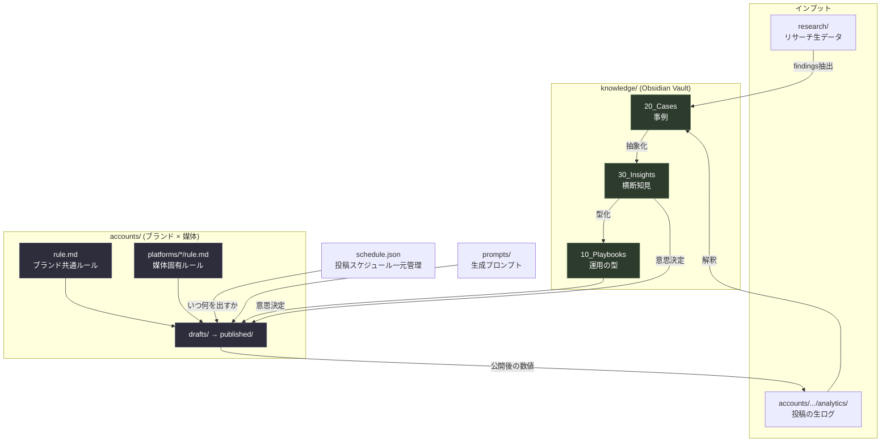
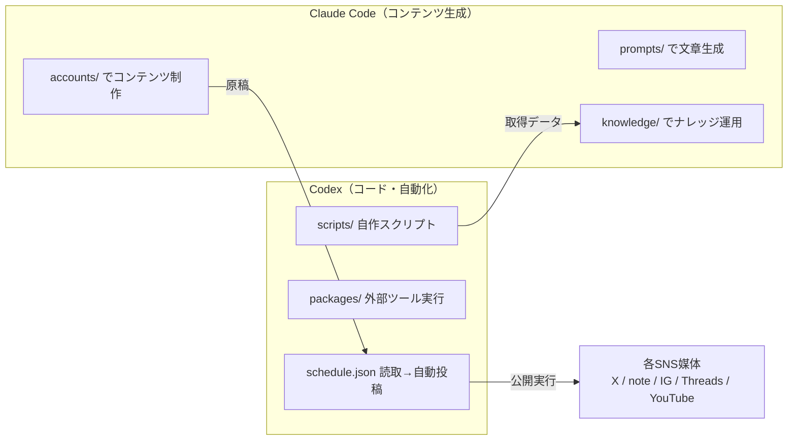
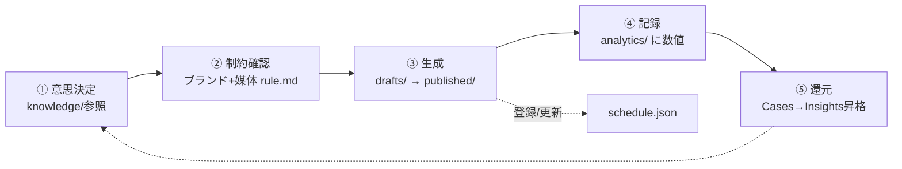

# SNS Account Management

複数のSNSブランドを **ブランド別 × 媒体別** に管理し、**Obsidian Vault（`knowledge/`）に貯めた運用ナレッジ**をもとに意思決定して運用するプロジェクト。
コンテンツ生成は **Claude Code**、コード・自動化は **Codex** が担当する2ツール共有環境。

- 全体ルール・判断フロー → [`CLAUDE.md`](./CLAUDE.md)
- Codex向け運用ガイド → [`AGENTS.md`](./AGENTS.md)

---

## ディレクトリ構成

```
sns-account-management/
├── CLAUDE.md              # 全体ルール・判断フロー（Claude担当）
├── AGENTS.md              # Codex向け運用ガイド（コード・自動化）
├── README.md              # このファイル
├── schedule.json          # 全ブランド・全媒体の投稿スケジュール（一元管理）
├── .mcp.json              # MCPサーバ設定
│
├── .claude/               # Claude Code 公式ディレクトリ
│   ├── settings.json
│   ├── skills/  agents/  commands/  rules/  memory/  agent_memory/
│
├── _templates/            # 各フォルダの雛形（accounts等を汚さない）
│   ├── account/           #   └ ブランド雛形（rule/profile + platforms/）
│   └── research/          #   └ リサーチ雛形（README/findings/raw）
│
├── accounts/              # ブランド別（1ブランド=1フォルダ・複数媒体を内包）
│   └── <brand>/
│       ├── rule.md        #   ブランド共通ルール
│       ├── profile.md     #   ペルソナ・ブランドボイス
│       └── platforms/<x|note|instagram|threads|youtube>/
│           ├── rule.md    #     媒体固有ルール（文字数等の制約）
│           ├── drafts/ published/ assets/ analytics/
│
├── prompts/               # コンテンツ生成プロンプト集
├── scripts/               # 自作スクリプト（Codex管轄）
├── packages/              # 外部パッケージ（note-research 等）
├── research/              # リサーチ生データ（YYYY-MM_テーマ/・raw はGit外）
│
└── knowledge/             # Obsidian Vault（運用ナレッジ蓄積）
    ├── .obsidian/         #   Obsidian設定
    ├── 00_Inbox/  10_Playbooks/  20_Cases/  30_Insights/
    ├── 99_Attachments/
    └── _templates/        #   ノート雛形（case / insight / playbook）
```

---

## 全体像（要素とツールの関わり）



---

## ツール役割分担



---

## 運用フロー



詳細な運用ルールは [`CLAUDE.md`](./CLAUDE.md) を参照。
